# The fortunes

The five on the menu, gone through **by running the disk** with the person it already has on its list (ああああ)
and, for the blood type, a second one (あい, entered with INPUT: see [The program](THE-PROGRAM.html)). Each fortune is
a part loaded at 0x9200 (p10, p0D, p07 and p1F) that goes on loading others at 0x9800 and 0x9C00; the big drawings
and the texts of the fortunes are read from the data sectors (251-1437) on each screen.

## Blood type (血液型相性占い)

Two people are chosen from the list. The two penguins wait on a tree stump with three balloons: «おわり» (end),
«総合» (overall) and «恋愛» (love).

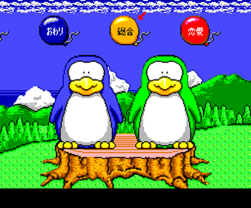

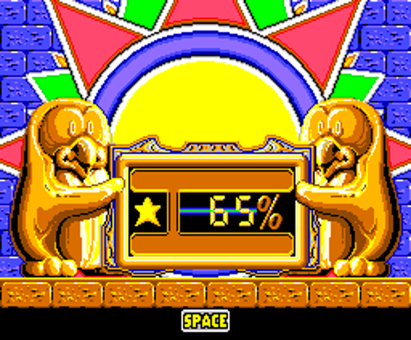

**The percentage is a sum of three tables** (part p13, 0x9800-0x9817): 0x9224 = 0x9221 + 0x9222 + 0x9223.

| term | where it comes from | table |
|---|---|---|
| 0x9221 | the **star sign** of each one, from the month and day of birth: the sign changes on the day given by the table at 0x986F for each month (20, 19, 21, 20, 21, 22, 23, 23, 23, 24, 22 and 22) | 12 x 12 at 0x9A3D |
| 0x9222 | the **first syllable of the name** of each one (not counting ゛ or ゜), in five groups by the table at 0x98A9: か行 = 0, た・な・ら行 = 1, あ・や・わ行 = 2, さ行 = 3, は・ま行 = 4 | 5 x 5 at 0x9ACD |
| 0x9223 | the **blood type** of each one, ordered by sex | 4 x 4: 0x9AE6 for a man and a woman, 0x9AF6 for two of the same sex |

The five groups of syllables are the classic split of Japanese name divination by the initial sound (the five
elements: wood, fire, earth, metal and water). In the recording, ああああ and あい were both born on 1 January
(sign 9: the month minus one plus nine, modulo 12, and one more past the day in the table; with Aries = 0 it is
Capricorn), both start with あ and both are type A: **35 + 13 + 17 = 65%**, the one on the screen.

## The omikuji (おみくじ)

The temple fortune: the penguin prays (ringing the bell, clapping) and shakes the box, with the eight topics beside
it (fortune, travel, wishes, studies, the awaited person, disputes, lost things, etc.); «すとっぷ» stops it.

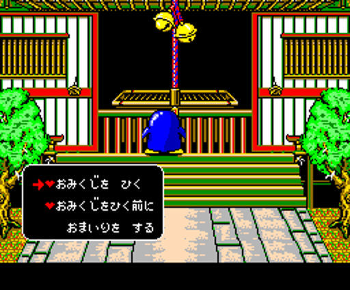

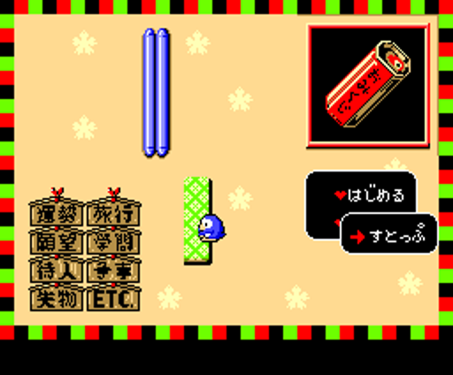

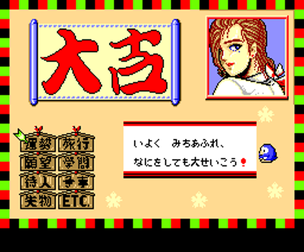

**How it comes out** (part p1A):

1. **The overall fortune** (0x9223, 0 to 7) is a byte of the **sound code** (0x4000 onwards) picked with the R
   register, the counter at 0xD1C3 and the IY register, keeping its three low bits (0x9DA3). It is the one shown big,
   with a portrait on the right read through the sector table at 0x9CC2 (seven portraits; with 7 none is read and
   the frame stays black, 0x9CA1).
2. That fortune chooses **how the box is filled**: two rows per fortune in the table at 0x9DD9, and a bit of R for one
   of the two. Each row is nine bytes: how many loose sticks are handed out at random and how many each of the eight
   levels gets. The first one of fortune 0: 1 loose and 5, 4, 3, 1, 1, 1, 0, 0 (16 sticks).
3. **The box holds 16 sticks** (0x9213-0x9222): each level is put in random slots (the R register, `ld a,r` at
   0x9EF3) and each stick also gets one of three variants (0x9EDF).
4. **Each stick brings its text**, 32 bytes: the one for its level and variant (level x 0x60 + variant x 0x20, at
   0x9D50 and 0x9D64) inside a block of 0x300 bytes (the eight levels of one topic); the blocks are read six sectors
   at a time from sector 949 (in the recording: 949, 955, 961 and 967, four blocks per read) and the texts are copied
   to 0xDE00 (0x9CD7-0x9D4F).

The eight levels, **forced**: before stopping the box, the overall fortune and the 16 sticks are all set to the same
level (0x9223 and 0x9213-0x9222 = 0, 1 ... 7) and the program is left to go on:

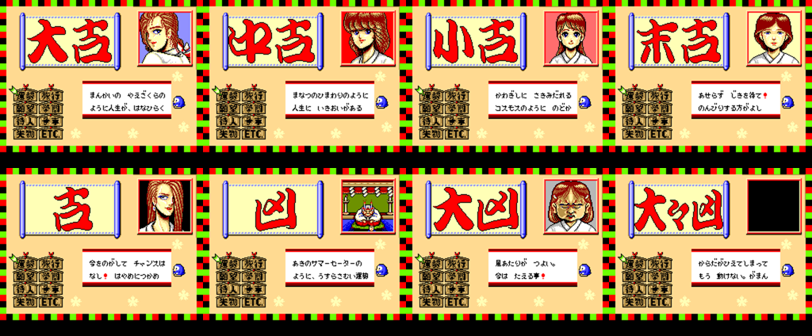

From 0 to 7: **大吉** (great blessing), **中吉** (middle blessing), **小吉** (small blessing), **末吉** (blessing
that comes in the end), **吉** (blessing), **凶** (bad luck), **大凶** (great bad luck) and **大々凶** (very great bad
luck), the last one without a portrait. The text is that of the first topic (fortune) with variant 0; they are
translated in [The texts](THE-TEXTS.html).

## The horoscope (西洋占星術)

The person's ascendant (上昇宮), the wheel of the twelve signs with the penguin in the middle and four topics:
character, love, health and money. The text goes to the TV or to the printer.

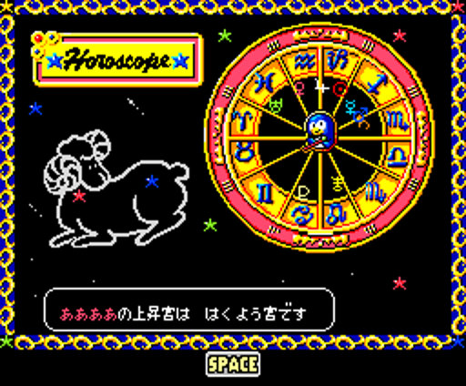

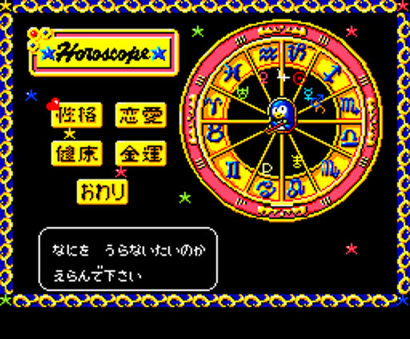

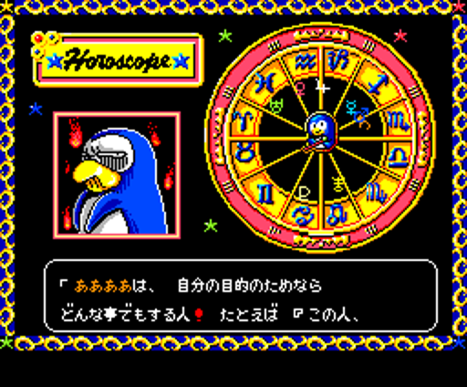

How it works out the ascendant is in the [open questions](CURIOSITIES.html#open-questions).

## Palm reading (手相占い)

First the hand is chosen: put your hands together with the fingers crossed, and the one with the thumb underneath is
the one that is read.

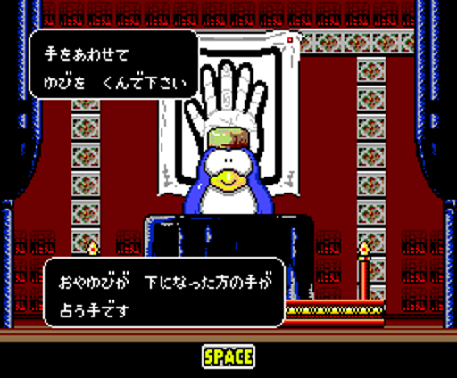

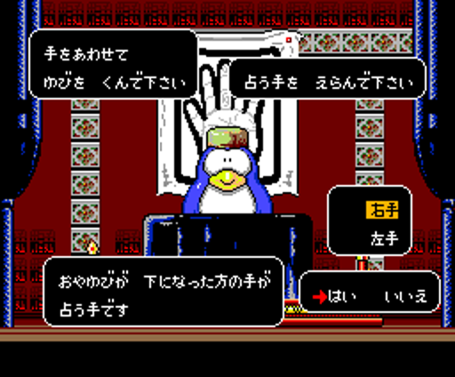

Then **seven lines**, one by one: the life line, the head line, the heart line, the fate line, the marriage line,
the whole hand and the other lines. On each one, left and right go through its shapes (4 for the life line, 8 for
the head line, 9 for the heart line, 11 for the fate line, 8 for the marriage line, 3 for the whole hand and 12 for
the others), drawn on the hand with an arrow and their description; space picks one, and the last option of the row
moves on to the next line (p24 0x9C62 and p1F 0x9378).

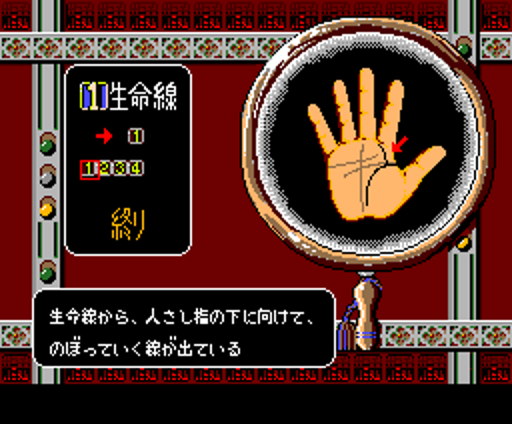

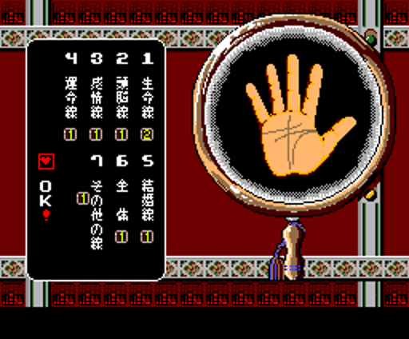

The seven answers are kept in the person's record (bytes 0x1C-0x22) and **the list is written to the disk** (sectors
1438-1439). Then, six topics (fortune, love, health, money, work and character) and the text, on the TV or on the
printer:

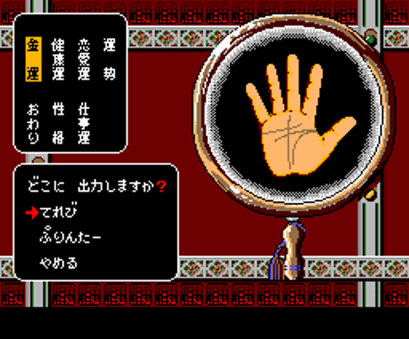

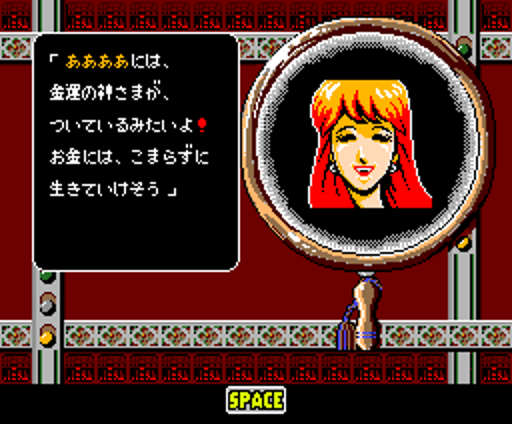

## The list of people (めいぼ)

It goes back to the main screen (see [The program](THE-PROGRAM.html)).
