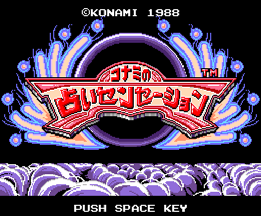
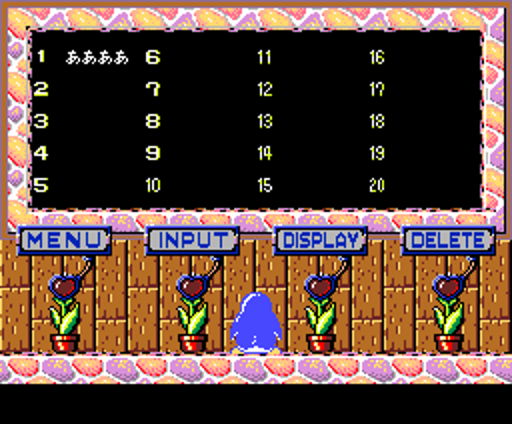
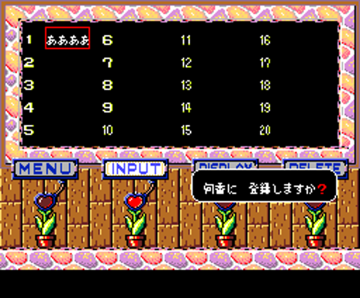
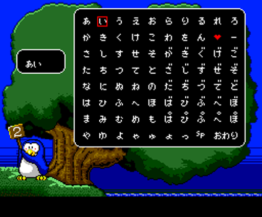
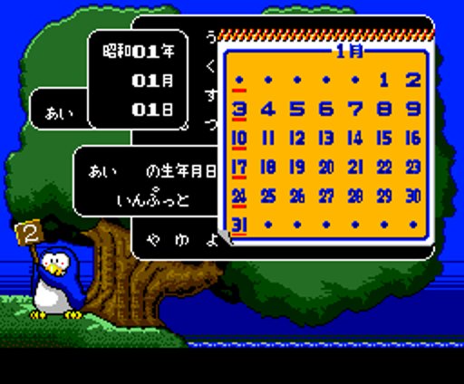
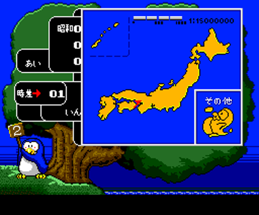
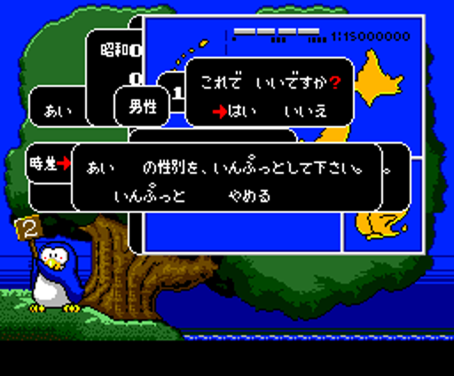
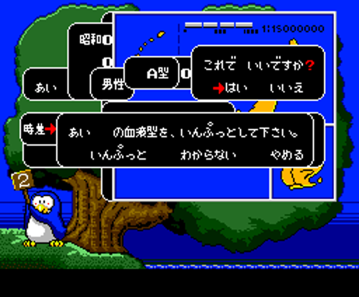
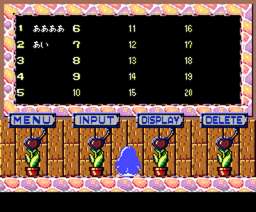
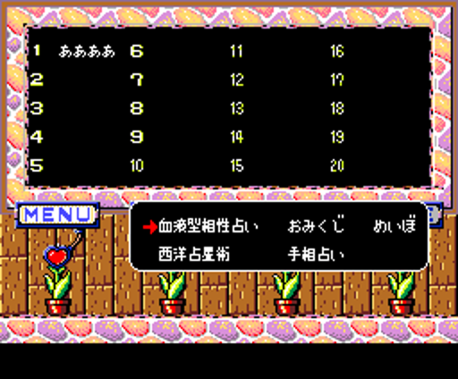

# The program

*Konami's Uranai Sensation* is not a game: it is a fortune-teller for the MSX2. Up to twenty people are entered and
a penguin tells their fortune in five ways. Every screen on this page comes from **running the disk**
(`tools/pantallas.py`, on the Z80 and V9938 of `tools/uranai_run.py`) pressing the keys its code asks for; the main
one is checked against openMSX: **0 bytes different** in the 128 KB of VRAM and in the palette.

## The keys

There is only one keyboard reader, the kernel's (0x8841): it reads the joystick (PSG register 14) and rows 4, 7 and
8 of the matrix, and leaves the keys just pressed at 0xD1C8 and those still held at 0xD1C9:

| bit | key |
|---|---|
| 0-3 | up, down, left, right (cursors or joystick) |
| 4 | space: accept |
| 5 | M: rub out the last letter of the name (p04 0xA68F) |
| 6 | RETURN |
| 7 | ESC: back |

## The title

The disk boots on its own, without MSX-DOS: sector 0 loads the kernel and the kernel loads the title part. Space
goes on to the main screen.

## The main screen

The list of the **twenty people** (sectors 1438-1439 of the disk, records of 0x30 bytes) and four buttons: MENU (the
fortunes), INPUT (enter a person), DISPLAY (show a record) and DELETE (delete it). The penguin walks from button to
button with the cursors and space presses its button.

The disk, as dumped, already has one person entered in slot 1: «ああああ». The record is in sector 1438 (the first
four bytes are code 0x01, «あ»).

## Entering a person (INPUT)

INPUT asks which slot to use and opens six questions in a row, with «input» or «quit» and, in all of them except the
name and the sex, «don't know». They are the data the fortunes use:

**The name**, from a table of letters: the cursor goes through 8 rows of 10 columns (p04 0xB175), and on the last row
«おわり» (end) takes columns 9 and 10; from column 9, right again takes the cursor back to the first letter.

**The date of birth** (in years of the Shōwa era, with a calendar of the month), **the place** (on a map of Japan at
1:15,000,000), **the time**, **the sex** and **the blood type**:

At the end the list is written back to the disk: the program calls the BDOS to **write** sectors 1438-1439
(function 0x30 of 0xF37D) from 0xD700. Here, with «あい» in slot 2:

## The menu of fortunes

MENU opens the list of the five: 血液型相性占い (match by blood type), おみくじ (the temple fortune), めいぼ (the list
of people: back to the main screen), 西洋占星術 (Western astrology) and 手相占い (palm reading). The person is
chosen on the list and confirmed with «はい». Each one is in [The fortunes](THE-FORTUNES.html).
