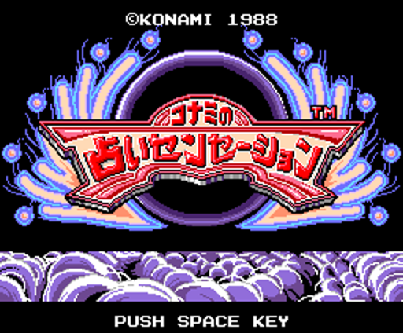
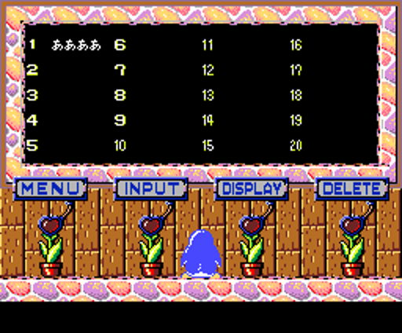
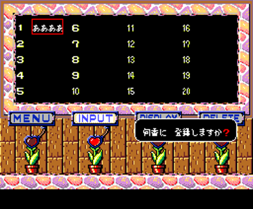
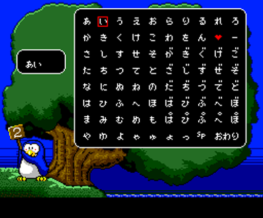
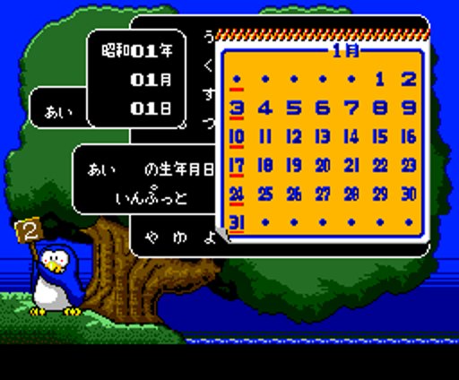
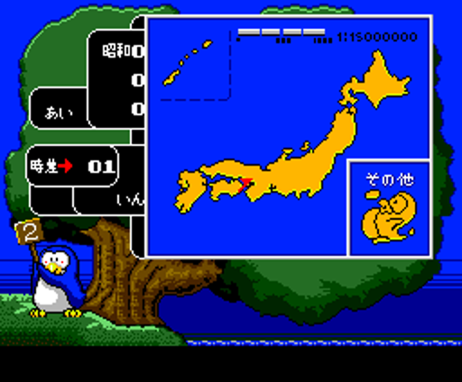
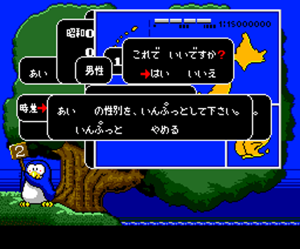
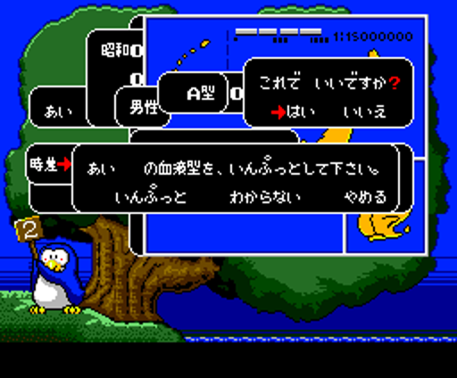
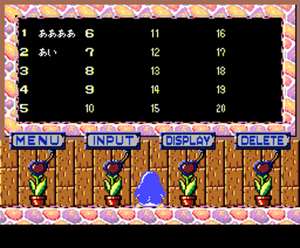
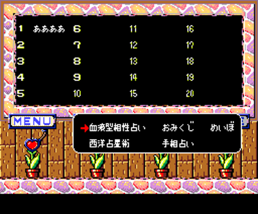

# El programa

*Konami's Uranai Sensation* no es un juego: es un adivino para MSX2. Se apuntan hasta veinte personas y un
pingüino les echa la suerte de cinco maneras. Todas las pantallas de esta página salen de **ejecutar el disco**
(`tools/pantallas.py`, sobre el Z80 y el V9938 de `tools/uranai_run.py`) pulsando las teclas que pide su código; la
principal está cotejada con openMSX: **0 bytes distintos** en los 128 KB de la VRAM y en la paleta.

## Las teclas

Solo hay un lector del teclado, el del núcleo (0x8841): lee la palanca del mando (registro 14 del PSG) y las filas
4, 7 y 8 de la matriz, y deja en 0xD1C8 las teclas recién pulsadas y en 0xD1C9 las que siguen pulsadas:

| bit | tecla |
|---|---|
| 0-3 | arriba, abajo, izquierda, derecha (cursores o mando) |
| 4 | espacio: aceptar |
| 5 | M: borrar la última letra del nombre (p04 0xA68F) |
| 6 | RETURN |
| 7 | ESC: volver |

## El título

El disco arranca solo, sin MSX-DOS: el sector 0 carga el núcleo y el núcleo la parte del título. Con el espacio se
pasa a la pantalla principal.

## La pantalla principal

La lista de las **veinte personas** (sectores 1438-1439 del disco, fichas de 0x30 bytes) y cuatro botones: MENU (las
adivinaciones), INPUT (apuntar a una persona), DISPLAY (ver una ficha) y DELETE (borrarla). El pingüino va de un botón
a otro con los cursores y el espacio pulsa el suyo.

El disco, tal como está volcado, ya trae a una persona apuntada en el hueco 1: «ああああ». La ficha se ve en el
sector 1438 (los cuatro primeros bytes son el código 0x01, «あ»).

## Apuntar a una persona (INPUT)

INPUT pregunta en qué hueco se apunta y abre seis preguntas seguidas, con «escribir» o «dejarlo» y, en todas menos
el nombre y el sexo, «no lo sé». Son los datos que usan las adivinaciones:

**El nombre**, de una tabla de letras: el cursor recorre 8 filas de 10 columnas (p04 0xB175), y en la última fila
«おわり» (terminar) ocupa las columnas 9 y 10; desde la 9, otra vez a la derecha, el cursor vuelve a la primera
letra.

**La fecha de nacimiento** (en años de la era Shōwa, con un calendario del mes), **el lugar** (en un mapa de Japón a
1:15.000.000), **la hora**, **el sexo** y **el grupo sanguíneo**:

Al terminar, la lista vuelve a grabarse en el disco: el programa llama a la BDOS para **escribir** los sectores
1438-1439 (función 0x30 de 0xF37D) desde 0xD700. Aquí, con «あい» en el hueco 2:

## El menú de adivinaciones

MENU abre la lista de las cinco: 血液型相性占い (compatibilidad por el grupo sanguíneo), おみくじ (la suerte del
templo), めいぼ (la lista de personas: vuelve a la pantalla principal), 西洋占星術 (astrología occidental) y 手相占い
(lectura de la mano). Se elige a la persona en la lista y se confirma con «はい». Cada una está en
[Las adivinaciones](LAS-ADIVINACIONES.html).
