# Las adivinaciones

Las cinco del menú, recorridas **ejecutando el disco** con la persona que trae apuntada (ああああ) y, para el grupo
sanguíneo, una segunda (あい, apuntada con INPUT: ver [El programa](EL-PROGRAMA.html)). Cada adivinación es una parte
que se carga en 0x9200 (p10, p0D, p07 y p1F) y va cargando otras en 0x9800 y 0x9C00; los dibujos grandes y los textos de las suertes se leen de
los sectores de datos (251-1437) en cada pantalla.

## El grupo sanguíneo (血液型相性占い)

Se eligen dos personas de la lista. Los dos pingüinos esperan en un tocón con tres globos: «おわり» (terminar),
«総合» (en conjunto) y «恋愛» (en el amor).

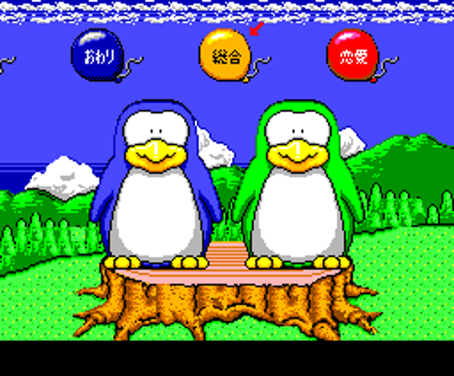

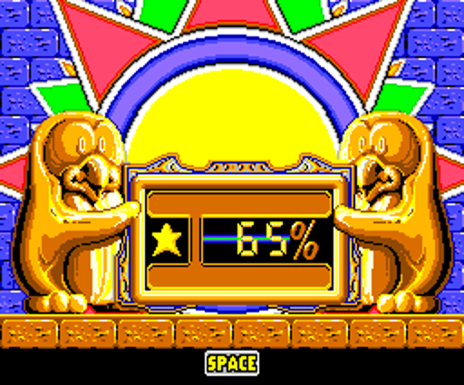

**El porcentaje es una suma de tres tablas** (parte p13, 0x9800-0x9817): 0x9224 = 0x9221 + 0x9222 + 0x9223.

| sumando | de qué sale | tabla |
|---|---|---|
| 0x9221 | el **signo del zodiaco** de cada uno, del mes y el día de nacimiento: el signo cambia el día que dice la tabla de 0x986F para cada mes (20, 19, 21, 20, 21, 22, 23, 23, 23, 24, 22 y 22) | 12 x 12 en 0x9A3D |
| 0x9222 | la **primera sílaba del nombre** de cada uno (sin contar ゛ ni ゜), en cinco grupos por la tabla de 0x98A9: か行 = 0, た・な・ら行 = 1, あ・や・わ行 = 2, さ行 = 3, は・ま行 = 4 | 5 x 5 en 0x9ACD |
| 0x9223 | el **grupo sanguíneo** de cada uno, ordenados por el sexo | 4 x 4: 0x9AE6 si son hombre y mujer, 0x9AF6 si son del mismo sexo |

Los cinco grupos de sílabas son el reparto clásico de la onomancia japonesa por el sonido inicial (los cinco
elementos: madera, fuego, tierra, metal y agua). En la grabación, ああああ y あい nacieron los dos el 1 de enero
(signo 9: el mes menos uno más nueve, módulo 12, y uno más pasado el día de la tabla; con Aries = 0 es
Capricornio), empiezan por あ y son del grupo A: **35 + 13 + 17 = 65 %**, el que
sale en la pantalla.

## La omikuji (おみくじ)

La suerte del templo: el pingüino reza (tocar la campana, dar las palmadas) y agita la caja, con los ocho temas al
lado (la suerte, los viajes, los deseos, los estudios, la persona esperada, los pleitos, lo perdido, etc.); se para
con «すとっぷ».

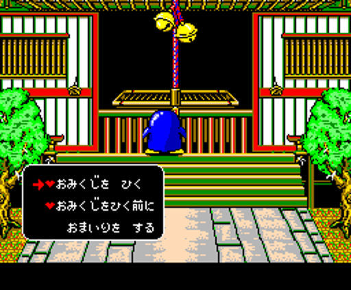

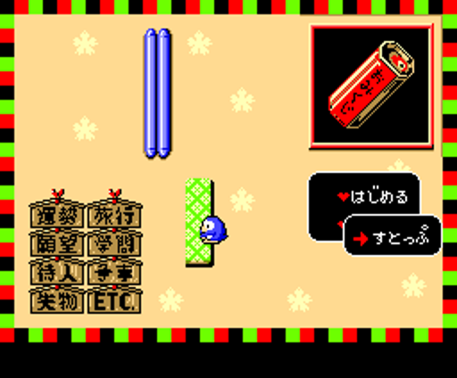

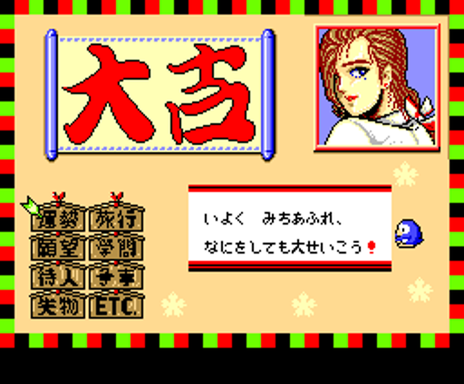

**Cómo sale** (parte p1A):

1. **La suerte general** (0x9223, de 0 a 7) es un byte del **código del sonido** (0x4000 en adelante) escogido con
   el registro R, el contador de 0xD1C3 y el registro IY, y quedándose con sus tres bits bajos (0x9DA3). Es la que
   sale en grande, con un retrato a la derecha que se lee de la tabla de sectores de 0x9CC2 (siete retratos; con
   el 7 no se lee ninguno y el recuadro queda negro, 0x9CA1).
2. Esa suerte elige **cómo se reparte la caja**: dos filas por suerte en la tabla de 0x9DD9, y un bit de R para una
   de las dos. Cada fila son nueve bytes: cuántos palillos sueltos se reparten al azar y cuántos lleva cada uno de
   los ocho niveles. La primera de la suerte 0: 1 suelto y 5, 4, 3, 1, 1, 1, 0, 0 (16 palillos).
3. **La caja tiene 16 palillos** (0x9213-0x9222): cada nivel se pone en huecos al azar (el registro R, `ld a,r` en
   0x9EF3) y cada palillo lleva además una de tres variantes (0x9EDF).
4. **Cada palillo trae su texto**, de 32 bytes: el de su nivel y su variante (nivel x 0x60 + variante x 0x20, en
   0x9D50 y 0x9D64) dentro de un bloque de 0x300 bytes (los ocho niveles de un tema); los bloques se leen de seis
   en seis sectores desde el 949 (en la grabación: 949, 955, 961 y 967, cuatro bloques por lectura) y los textos
   se copian a 0xDE00 (0x9CD7-0x9D4F).

Los ocho niveles, **forzados**: antes de parar la caja se ponen la suerte general y los 16 palillos en el mismo
nivel (0x9223 y 0x9213-0x9222 = 0, 1 ... 7) y se deja seguir al programa:

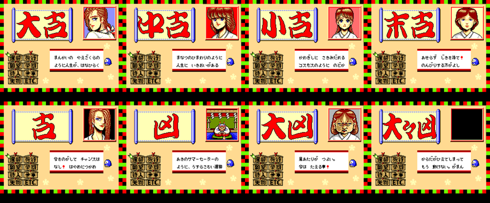

Del 0 al 7: **大吉** (la gran suerte), **中吉** (suerte media), **小吉** (suerte pequeña), **末吉** (suerte que
llega al final), **吉** (suerte), **凶** (mala suerte), **大凶** (muy mala suerte) y **大々凶** (malísima), este
último sin retrato. El texto es el del primer tema (la suerte) con la variante 0; están traducidos en
[Los textos](LOS-TEXTOS.html).

## El horóscopo (西洋占星術)

El ascendente (上昇宮) de la persona, la rueda de los doce signos con el pingüino en el centro y cuatro temas: el
carácter, el amor, la salud y el dinero. El texto se saca por la tele o por la impresora.

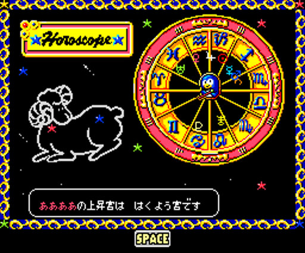

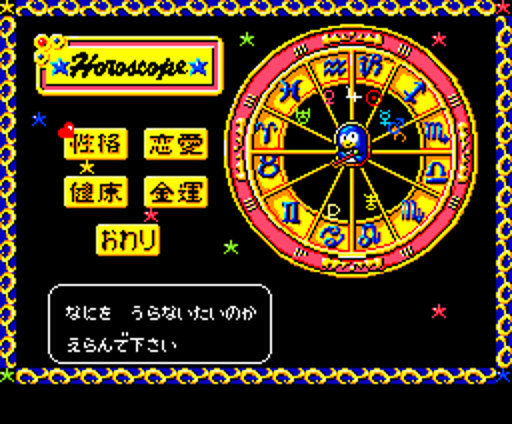

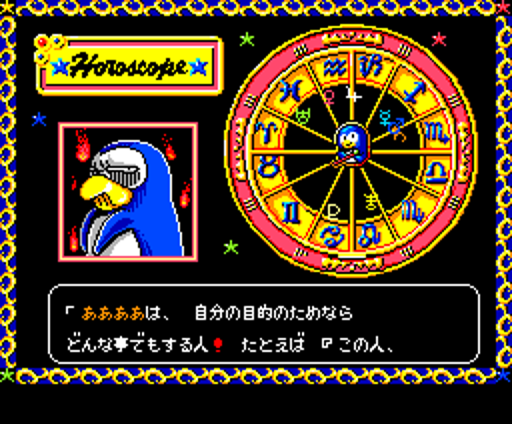

Cómo calcula el ascendente está en las [preguntas abiertas](CURIOSIDADES.html#preguntas-abiertas).

## La lectura de la mano (手相占い)

Primero se elige la mano: se juntan las manos con los dedos cruzados, y la del pulgar de abajo es la que se lee.

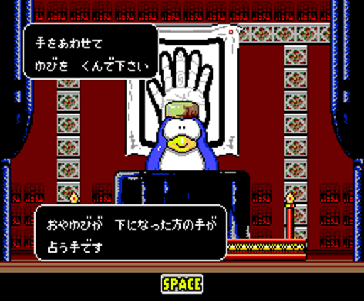

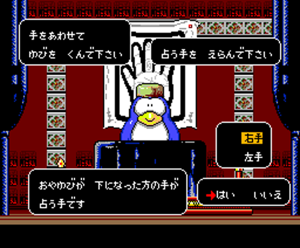

Después, **siete líneas**, una a una: la de la vida, la de la cabeza, la del corazón, la del destino, la del
matrimonio, el conjunto y las demás. En cada una, izquierda y derecha pasan por sus formas (4 en la de la vida, 8 en
la de la cabeza, 9 en la del corazón, 11 en la del destino, 8 en la del matrimonio, 3 en el conjunto y 12 en las
demás), dibujadas sobre la mano con una flecha y su descripción; el espacio la elige, y la
última opción de la fila pasa a la línea siguiente (p24 0x9C62 y p1F 0x9378).

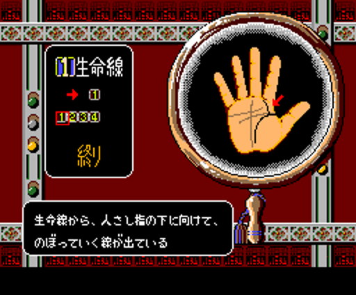

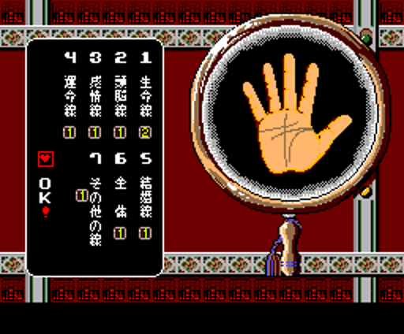

Las siete respuestas se guardan en la ficha de la persona (bytes 0x1C-0x22) y **la lista se graba en el disco**
(sectores 1438-1439). Luego, seis temas (la suerte, el amor, la salud,
el dinero, el trabajo y el carácter) y el texto, por la tele o por la impresora:

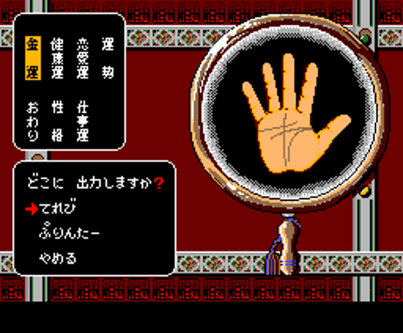

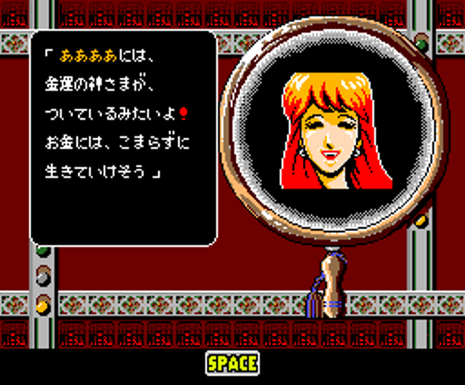

## La lista de personas (めいぼ)

Vuelve a la pantalla principal (ver [El programa](EL-PROGRAMA.html)).
